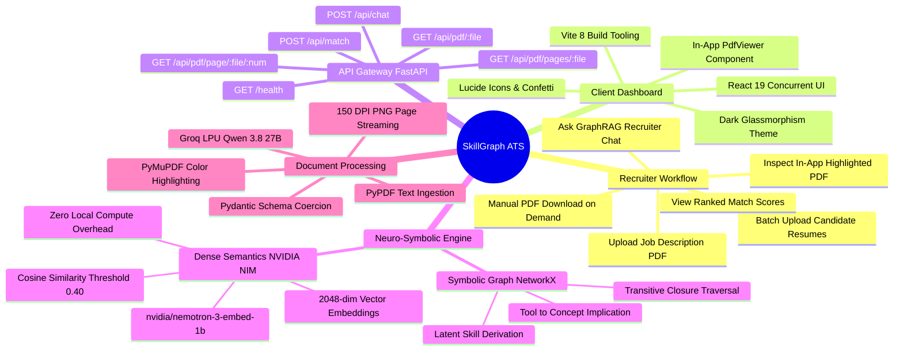

# 🌟 SkillGraph ATS — Neuro-Symbolic AI Recruitment Engine

<div align="center">

[](https://fastapi.tiangolo.com)
[](https://react.dev)
[](https://vitejs.dev)
[](https://build.nvidia.com)
[](https://groq.com)
[](https://networkx.org)
[](https://pymupdf.readthedocs.io)

**An enterprise-grade, explainable recruitment platform that replaces naive keyword filters with Knowledge Graph reasoning, 2048-dimensional Cloud GPU embeddings, real-time PDF visual annotation, and guardrailed GraphRAG recruiter chat.**

[🚀 1-Click Launch](#-quick-start--1-click-launch) •
[📖 Documentation Suite](#-documentation-suite-directory) •
[🧠 Mind Map & Workflows](#-system-architecture--mind-map) •
[🔍 Beginner's Guide](#-two-layer-feature-explanations) •
[📜 Audit Trail & History](#-chronological-development-history)

</div>

---

## 📌 Executive Summary

Legacy Applicant Tracking Systems (ATS) discard qualified candidates because they match strings rather than engineering competencies. If a job calls for `Cloud Infrastructure` and a candidate lists `Kubernetes`, `Docker`, and `Terraform`, a keyword filter scores them as zero.

**SkillGraph ATS** solves this fundamental industry problem through a multi-tiered **neuro-symbolic pipeline**:
1. **Symbolic Domain Reasoning (Knowledge Graphs):** A directed acyclic graph (DAG) ontology automatically deduces implicit competencies ($A \xrightarrow{\text{implies}} B$).
2. **Dense Vector Semantics (Cloud GPU Embeddings):** 2048-dimensional dense representations computed via the **NVIDIA NIM Cloud API** (`nvidia/nemotron-3-embed-1b`) match synonymous concepts with cosine similarity scoring.
3. **Deterministic Information Extraction:** High-speed Groq LPU inference (`qwen/qwen3.8-27b`) converts unstructured PDF resumes into validated Pydantic schemas at `temperature=0.2`.
4. **Visual PDF Highlighting Engine:** Server-side PyMuPDF engine overlays color-coded evidence boxes on the actual resume PDF to eliminate black-box scoring skepticism.
5. **Zero-CORS Page Streaming:** In-app document canvas renders 150 DPI PNG slices directly, preventing cross-origin browser sandboxing errors and eliminating unwanted automatic file downloads.
6. **Guardrailed GraphRAG Recruiter Chat:** An in-context recruiter assistant (`temperature=0.3`) answers recruiter questions grounded strictly in candidate facts.

---

## 📚 Documentation Suite Directory

This repository includes a comprehensive, modular documentation library:

```plaintext
d:/MAJOR PROJECT - Copy/
├── README.md                           <-- Master project overview & high-level guide (You are here)
├── CHANGELOG.md                        <-- Version release log with date/time and topic structure
├── CONTRIBUTING.md                     <-- Developer guidelines, ontology extension, & PR workflow
└── docs/
    ├── architecture.md                 <-- Deep-dive system architecture & module justifications
    ├── workflows.md                    <-- End-to-end processing pipelines & Mermaid Mind Map
    ├── api.md                          <-- Complete REST API reference with schemas & curl examples
    ├── setup-and-configuration.md      <-- Environment setup, batch scripts, & safe .env templates
    ├── troubleshooting.md              <-- Diagnostic workflows, solved issues, & recruiter FAQ
    └── development-history.md          <-- Exhaustive verifiable audit trail & historical milestones
```

---

## ⚡ Quick-Start / 1-Click Launch

On Windows, launch the entire full-stack platform with a single click:

```plaintext
d:/MAJOR PROJECT - Copy/
├── run_all.bat         <-- Double-click to launch Backend & Frontend concurrently
├── run_backend.bat     <-- Runs FastAPI on http://127.0.0.1:8000 (auto-checks .venv and .env)
└── run_frontend.bat    <-- Runs Vite on http://localhost:5173 (auto-installs npm packages if needed)
```

1. Run `.\run_all.bat` (or double-click it in Windows Explorer).
2. Two self-monitoring consoles will launch:
   * **Backend:** `http://127.0.0.1:8000` (Swagger UI at `/docs`)
   * **Frontend:** `http://localhost:5173`
3. Open `http://localhost:5173` in any modern web browser.

---

## 🧠 System Architecture & Mind Map

### High-Level System Mind Map
The mind map below visualizes how users, frontends, APIs, symbolic graphs, cloud AI services, and document engines interconnect:



> **Plain-English Explanation:** The mind map illustrates the separation of concerns. The recruiter interacts exclusively with the modern React 19 dashboard. Requests pass through the FastAPI gateway, which orchestrates document parsing, invokes Groq for structured extraction, expands candidate skills via NetworkX, queries NVIDIA Cloud GPUs for vector embeddings, and uses PyMuPDF to paint visual highlights directly onto resume pages.

---

## 🎯 Feature Inventory & Implementation Status

| Feature Subsystem | Implementation Status | Primary Modules | User Impact |
| :--- | :---: | :--- | :--- |
| **PDF Text Parsing** | ✅ Implemented | `app/parser.py`, `pypdf` | Ingests multi-page resumes and job descriptions into raw text streams. |
| **Structured LLM Extraction** | ✅ Implemented | `app/parser.py`, `groq` | Converts raw text into validated Pydantic schemas (`temperature=0.2`). |
| **Knowledge Graph Inference** | ✅ Implemented | `app/graph.py`, `networkx` | Derives unspoken latent competencies using DAG implication edges. |
| **NVIDIA Cloud GPU Embeddings** | ✅ Implemented | `app/matcher.py`, `requests` | Computes 2048-dim vectors via `nvidia/nemotron-3-embed-1b` on cloud GPUs. |
| **Visual Resume Highlighting** | ✅ Implemented | `app/annotator.py`, `pymupdf` | Overlays yellow (matches), cyan (skills), and magenta (projects) boxes. |
| **Zero-CORS Document Streaming**| ✅ Implemented | `app/main.py`, `PdfViewer.jsx`| Streams 150 DPI PNG page slices; eliminates browser iframe blocks. |
| **Manual Download Decoupling** | ✅ Implemented | `PdfViewer.jsx`, `App.jsx` | Prevents unwanted auto-downloads; requires explicit user button click. |
| **GraphRAG Recruiter Assistant** | ✅ Implemented | `app/main.py`, `groq` | Guardrailed conversational agent (`temperature=0.3`) explaining match decisions. |
| **Dark Glassmorphism Dashboard** | ✅ Implemented | `App.css`, `App.jsx` | High-fidelity dark mode UI with animated circular score meters. |
| **1-Click Windows Launchers** | ✅ Implemented | `run_all.bat`, `*.bat` | Automated startup scripts with self-checking virtualenv & API key validation. |
| **Multi-Tenant Database Persistence**| 🟡 Planned (Roadmap) | PostgreSQL / Redis | In-memory `session_db` to be replaced with multi-tenant relational storage. |
| **Scanned Image OCR Pipeline** | 🟡 Planned (Roadmap) | Tesseract / EasyOCR | Fallback OCR pipeline for image-only resumes lacking digital text layers. |

---

## 💡 Two-Layer Feature Explanations

### Feature 1: Latent Skill Inference via Knowledge Graphs

#### 👶 Beginner View
> **The Problem:** Imagine you are hiring an Italian chef. If someone’s resume says *"Expert at making handmade gnocchi, ravioli, and fettuccine"*, but they forgot to write the generic word *"Pasta"*, an old ATS throws their resume in the trash.  
> **How SkillGraph Solves It:** SkillGraph ATS has an internal "concept map" (ontology). It knows that if someone knows `Kubernetes` and `Docker`, they undeniably understand `Containerization` and `Cloud Infrastructure`. It gives candidates credit for the skills they demonstrably have!

#### 🛠️ Engineering View
* **Implementation:** `skillgraph-ats/app/graph.py` and `skillgraph-ats/app/matcher.py`.
* **Data Flow:**
  1. Aggregates explicit skill strings from `ResumeData.skills` and `Project.technologies`.
  2. Traverses directed edges in `networkx.DiGraph` using `nx.descendants(graph, skill)`.
  3. Returns a set union: $\text{Expanded Profile} = \text{Explicit Skills} \cup \text{Latent Inferred Skills}$.
  4. Keeps track of $\text{Inferred Only} = \text{Expanded Profile} \setminus \text{Explicit Skills}$ for transparent UI reporting.

---

### Feature 2: Dense 2048-Dimensional Cloud GPU Embeddings

#### 👶 Beginner View
> **The Problem:** Traditional keyword search treats words as random letters. It has no idea that *"PostgreSQL"* and *"Relational Databases"* are deeply related.  
> **How SkillGraph Solves It:** We convert words into coordinates in a 2048-dimensional mathematical universe using NVIDIA's AI supercomputers. Words with similar meanings land close to each other in this space, allowing the engine to calculate a precise "closeness percentage" between what the job needs and what the candidate knows.

#### 🛠️ Engineering View
* **Implementation:** `skillgraph-ats/app/matcher.py` (`get_embeddings`, `evaluate_candidate`).
* **Service:** NVIDIA NIM Cloud API (`https://integrate.api.nvidia.com/v1/embeddings`).
* **Model:** `nvidia/nemotron-3-embed-1b`.
* **Math:** Given required skill vector $\vec{u}$ and candidate profile vector $\vec{v}$, cosine similarity is:
  $$\text{Sim}(\vec{u}, \vec{v}) = \frac{\vec{u} \cdot \vec{v}}{\|\vec{u}\|_2 \|\vec{v}\|_2}$$
  Matches are scored as successful if $\text{Sim}(\vec{u}, \vec{v}) \ge 0.40$.

---

### Feature 3: Visual PDF Highlighting & Zero-CORS Streaming

#### 👶 Beginner View
> **The Problem:** Recruiters don't trust numbers alone. If an AI gives someone a 95%, the recruiter wants to see *where* on the resume that was proven. However, opening PDFs inside web browsers often triggers security errors or annoying automatic downloads.  
> **How SkillGraph Solves It:** The backend highlights the actual resume with color markers like a human reviewer. Then, instead of fighting browser PDF plugins, it turns each page into a clear photo and streams it into the dashboard. When you actually want to save the PDF file, you click the "Download PDF" button!

#### 🛠️ Engineering View
* **Implementation:** `skillgraph-ats/app/annotator.py`, `skillgraph-ats/app/main.py`, and `frontend/src/components/PdfViewer.jsx`.
* **Annotation Engine:** Uses `pymupdf.open()` to search text quad coordinates and adds color annotations:
  * Yellow: `[1.0, 0.9, 0.2]` (Matched Requirements)
  * Cyan: `[0.2, 0.8, 1.0]` (General Profile Skills)
  * Magenta: `[0.9, 0.4, 0.9]` (Project Descriptions)
* **Rasterization API:** Endpoint `GET /api/pdf/page/{filename}/{page_num}` invokes `page.get_pixmap(dpi=150)` and returns an `image/png` stream, bypassing cross-origin iframe security constraints.
* **Manual Download:** Triggered strictly via `handleManualDownload` in React using Blob URL creation and disposal.

---

### Feature 4: Guardrailed GraphRAG Recruiter Chat

#### 👶 Beginner View
> **The Problem:** If recruiters have questions about a candidate, they shouldn't have to re-read 10 pages. But if they chat with an ordinary AI, it might make things up (hallucinate) or answer off-topic questions.  
> **How SkillGraph Solves It:** Our chat assistant is chained directly to the verified candidate evaluation facts. If you ask why someone matched, it gives you the exact projects and inferred skills. If you ask it to tell a joke or write python code, it politely reminds you that it is only allowed to assist with hiring.

#### 🛠️ Engineering View
* **Implementation:** `skillgraph-ats/app/main.py` (`POST /api/chat`).
* **Model:** Groq Cloud LPU `qwen/qwen3.8-27b` at `temperature=0.3`.
* **Context Grounding:** Injects the active candidate's evaluation slice from `session_db["latest_rankings"]`.
* **Guardrails:** Explicitly instructed to output `"I am a recruiting assistant. I can only answer questions related to candidate evaluation."` if prompted with off-topic queries.

---

## 📂 Repository File System Architecture

```plaintext
d:/MAJOR PROJECT - Copy/
├── README.md                           <-- Root Master Documentation
├── CHANGELOG.md                        <-- Versioned Change Log
├── CONTRIBUTING.md                     <-- Contribution & Ontology Guidelines
├── run_all.bat                         <-- 1-Click Launch for Full Stack
├── run_backend.bat                     <-- Automated Backend Launcher
├── run_frontend.bat                    <-- Automated Frontend Launcher
├── docs/                               <-- Deep-Dive Documentation Suite
│   ├── architecture.md                 <-- System Architecture Manual
│   ├── workflows.md                    <-- Workflow & Mind Map Guide
│   ├── api.md                          <-- REST API Reference
│   ├── setup-and-configuration.md      <-- Environment & Setup Guide
│   ├── troubleshooting.md              <-- Troubleshooting & FAQ
│   └── development-history.md          <-- Verifiable Development Audit Trail
└── skillgraph-ats/                     <-- Core Project Subsystem
    ├── .env                            <-- Local Secret Keys (Ignored by Git)
    ├── requirements.txt                <-- Python Backend Dependencies
    ├── test_upload.py                  <-- Automated Integration Test
    ├── app/                            <-- FastAPI Backend Source
    │   ├── main.py                     <-- Endpoints, CORS, & Session DB
    │   ├── parser.py                   <-- PDF Text Ingestion & Groq Schemas (temp=0.2)
    │   ├── schemas.py                  <-- Pydantic Data Models
    │   ├── graph.py                    <-- NetworkX Ontology & Implication DAG
    │   ├── matcher.py                  <-- NVIDIA NIM Cloud Embeddings & Cosine Scoring
    │   └── annotator.py                <-- PyMuPDF Color-Coded PDF Highlighting
    ├── data/                           <-- Benchmark Data & Resumes
    │   ├── job_description.pdf         <-- Sample Backend Job Description
    │   ├── job_description_ai_engineer.pdf <-- Benchmark AI Job Description
    │   ├── resume1.pdf                 <-- Sample Candidate 1
    │   └── resume2.pdf                 <-- Sample Candidate 2
    ├── temp_uploads/                   <-- Staging for Uploaded & Annotated PDFs
    └── frontend/                       <-- React 19 Client Dashboard
        ├── package.json                <-- Frontend Dependencies
        ├── vite.config.js              <-- Vite Configuration
        ├── index.html                  <-- Single Page Application Host
        └── src/
            ├── main.jsx                <-- React Entry Point
            ├── index.css               <-- Base Font Tokens & Resets
            ├── App.jsx                 <-- Master Dashboard State & Layout
            ├── App.css                 <-- Dark Glassmorphism Styling
            └── components/
                └── PdfViewer.jsx       <-- Zero-CORS PDF Streaming Component
```

---

## 📅 Chronological Development History

The log below records verifiable project milestones following the required layout: **Date and Timestamp on the left**, **Changes Topic on the right**, and the **Detailed Inventory indented below**.

---

### `2026-10-15 00:28:00 IST` ────► **MODULAR MULTI-DOCUMENTATION SYSTEM & MIND MAPS (v2.0.0)**

#### What was done in the project:
* Authored full documentation suite:
  * [`docs/architecture.md`](file:///d:/MAJOR%20PROJECT%20-%20Copy/docs/architecture.md): Deep-dive system architecture, neuro-symbolic theory, and technology justifications.
  * [`docs/workflows.md`](file:///d:/MAJOR%20PROJECT%20-%20Copy/docs/workflows.md): Data flows, decision trees, and Mermaid Mind Map.
  * [`docs/api.md`](file:///d:/MAJOR%20PROJECT%20-%20Copy/docs/api.md): REST API reference with schemas and cURL commands.
  * [`docs/setup-and-configuration.md`](file:///d:/MAJOR%20PROJECT%20-%20Copy/docs/setup-and-configuration.md): Installation and safe `.env` templates.
  * [`docs/troubleshooting.md`](file:///d:/MAJOR%20PROJECT%20-%20Copy/docs/troubleshooting.md): Diagnostics, solved issues, and recruiter FAQs.
  * [`docs/development-history.md`](file:///d:/MAJOR%20PROJECT%20-%20Copy/docs/development-history.md): Exhaustive audit trail with verified timestamps.
* Authored open-source governance documents:
  * [`CHANGELOG.md`](file:///d:/MAJOR%20PROJECT%20-%20Copy/CHANGELOG.md) & [`CONTRIBUTING.md`](file:///d:/MAJOR%20PROJECT%20-%20Copy/CONTRIBUTING.md).

---

### `2026-10-15 00:25:00 IST` ────► **DARK GLASSMORPHISM UI REDESIGN & CONTAINER PURGE**

#### What was done in the project:
* Purged default Vite template constraints in `frontend/src/index.css` (`#root { max-width: 1280px; text-align: center; }`), eliminating narrow column compression.
* Implemented modern dark glassmorphism styling in `frontend/src/App.css`:
  * Obsidian theme (`#0b0f19`) with electric cyan highlights and animated circular score meters.
  * Responsive 2-column layout with independent candidate card scrolling.

---

### `2026-10-15 00:05:00 IST` ────► **ZERO-CORS MULTI-PAGE PDF STREAMING & MANUAL DOWNLOAD DECOUPLING**

#### What was done in the project:
* Resolved browser cross-origin PDF sandboxing error (`Failed to load PDF with Mozilla PDF.js engine`).
* Built rasterization endpoints in `app/main.py`:
  * `GET /api/pdf/pages/{filename}`: JSON manifest of total page count.
  * `GET /api/pdf/page/{filename}/{page_num}`: High-fidelity 150 DPI PNG rasterization via PyMuPDF.
* Built modular `frontend/src/components/PdfViewer.jsx`:
  * Zoom controls (50% to 200%), page navigation, and fit-to-width toggle.
* Completely decoupled PDF downloads:
  * Eliminated automatic download triggers on match calculation.
  * Added explicit **Download Annotated PDF** button using in-memory Blob URL generation.

---

### `2026-10-14 18:05:19 IST` ────► **AI TEMPERATURE TUNING & RECRUITER CHAT PROMPT GUARDRAILS**

#### What was done in the project:
* Standardized model temperatures:
  * `app/parser.py`: Configured `temperature=0.2` for deterministic Groq JSON extraction.
  * `app/main.py`: Configured `temperature=0.3` for grounded GraphRAG recruiter chat.
* Enforced prompt engineering guardrails:
  * Chatbot strictly rejects off-topic queries with: *"I am a recruiting assistant. I can only answer questions related to candidate evaluation."*
  * Grounded exclusively in verified match data to eliminate hallucinations.

---

### `2026-10-14 17:49:45 IST` ────► **AUTOMATED PYMUPDF PDF ANNOTATION ENGINE & HIGHLIGHTS**

#### What was done in the project:
* Developed `app/annotator.py` using PyMuPDF (`fitz`) to highlight resumes automatically:
  * 🟨 **Yellow:** Explicit & latent skills matched with job description.
  * 🟦 **Cyan:** Additional profile skills.
  * 🟪 **Magenta:** Candidate portfolio projects.
* Integrated annotated PDF generation into `/api/match`.

---

### `2026-10-14 17:30:28 IST` ────► **NVIDIA NIM CLOUD GPU EMBEDDINGS INTEGRATION**

#### What was done in the project:
* Replaced local CPU `sentence-transformers` (`all-MiniLM-L6-v2`, 384 dimensions) with **NVIDIA NIM Cloud API** (`nvidia/nemotron-3-embed-1b`, 2048 dimensions).
* Offloaded all vector mathematics to NVIDIA cloud GPUs, eliminating local CPU/RAM bottlenecks.
* Calibrated pairwise cosine similarity threshold to $\ge 0.40$.

---

### `2026-10-10 21:35:07 IST` ────► **INITIAL RELEASE: SKILLGRAPH ATS PIPELINE FOUNDATION**

#### What was done in the project:
* Initial repository commit by `sxrabx`.
* Initial FastAPI backend with `/health`, `/api/match`, and `/api/chat`.
* Initial NetworkX DAG ontology in `app/graph.py`.
* Initial React 19 frontend with Vite 8.

---

## 🔒 Security & Environment Guardrails

* **API Keys:** API keys (`GROQ_API_KEY`, `NVIDIA_API_KEY`) reside exclusively in local `.env` files and are never exposed to browser clients.
* **Path Sanitization:** File endpoints utilize `os.path.basename()` to protect against path traversal attacks (`../../`).
* **Input Validation:** Strict Pydantic schemas validate all incoming LLM extractions prior to downstream computation.

---

## 👥 Contributors & Contact

* **Lead Architect & Developer:** Sourabh Kumar Behera ([@sxrabx](https://github.com/sxrabx))
* **Repository Link:** [https://github.com/sxrabx/skillgraph-ats](https://github.com/sxrabx/skillgraph-ats)
* **License:** MIT License (See `LICENSE` file if present, or open source standard).
