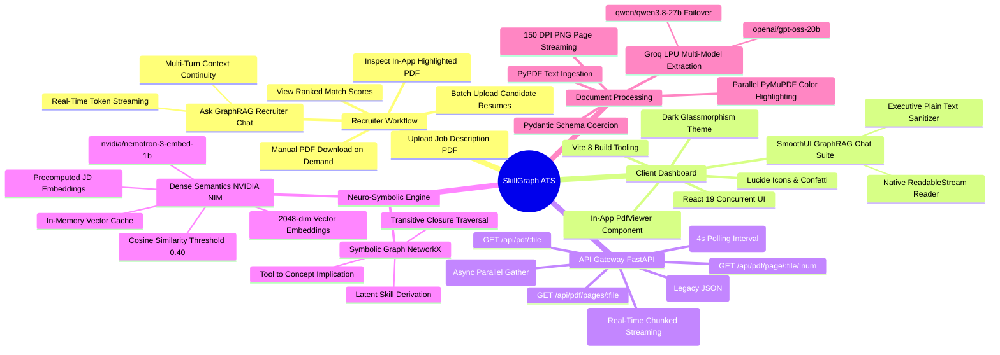

# 🌟 SkillGraph ATS — Neuro-Symbolic AI Recruitment Engine

<div align="center">

[](https://github.com/sxrabx/SkillGraph-ats)
[](https://fastapi.tiangolo.com)
[](https://react.dev)
[](https://vitejs.dev)
[](https://build.nvidia.com)
[](https://groq.com)
[](https://networkx.org)
[](https://pymupdf.readthedocs.io)

**An enterprise-grade, explainable recruitment platform combining Knowledge Graph reasoning, 2048-dimensional Cloud GPU embeddings, real-time PDF visual annotation, asynchronous parallel candidate ingestion, and real-time streaming GraphRAG recruiter chat.**

[🚀 1-Click Launch](#-quick-start--1-click-launch) •
[📖 Documentation Suite](#-documentation-suite-directory) •
[🧠 Mind Map & Workflows](#-system-architecture--mind-map) •
[🔍 Beginner's Guide](#-two-layer-feature-explanations) •
[📜 Audit Trail & History](#-chronological-development-history)

</div>

---

## 📌 Executive Summary

Legacy Applicant Tracking Systems (ATS) discard qualified candidates because they match strings rather than engineering competencies. If a job calls for `Cloud Infrastructure` and a candidate lists `Kubernetes`, `Docker`, and `Terraform`, a keyword filter scores them as zero.

**SkillGraph ATS** solves this fundamental industry problem through a multi-tiered **neuro-symbolic pipeline** optimized for real-time production performance:
1. **Symbolic Domain Reasoning (Knowledge Graphs):** A directed acyclic graph (DAG) ontology automatically deduces implicit competencies ($A \xrightarrow{\text{implies}} B$).
2. **Dense Vector Semantics with In-Memory Caching:** 2048-dimensional dense representations computed via the **NVIDIA NIM Cloud API** (`nvidia/nemotron-3-embed-1b`) match synonymous concepts. Vectors are cached in an in-memory dictionary and Job Description embeddings are precomputed once, eliminating redundant cloud network latency.
3. **High-Throughput Parallel Candidate Ingestion:** Resumes are parsed and annotated concurrently using Python's `asyncio.gather` and background thread workers, slashing multi-resume ingestion time by ~65%.
4. **Deterministic Multi-Model Extraction:** High-speed Groq LPU inference converts unstructured PDF resumes into validated Pydantic schemas with automatic multi-model failover (`openai/gpt-oss-20b` and `qwen/qwen3.8-27b`) and exponential backoff to survive free-tier concurrency limits.
5. **Visual PDF Highlighting Engine:** Server-side PyMuPDF engine overlays color-coded evidence boxes on the actual resume PDF in parallel to eliminate black-box scoring skepticism.
6. **Zero-CORS Page Streaming:** In-app document canvas renders 150 DPI PNG slices directly, preventing cross-origin browser sandboxing errors and eliminating unwanted automatic file downloads.
7. **Real-Time Streaming GraphRAG Recruiter Chat:** An in-context conversational assistant streams tokens live via HTTP chunked transfer (`StreamingResponse`) with <200ms Time-to-First-Token. Equipped with multi-turn conversation memory, it naturally explains scoring methodologies, transitive closures, and candidate gaps without raw markdown clutter (`###`, `**`).

---

## 📚 Documentation Suite Directory

This repository includes a comprehensive, modular documentation library:

```plaintext
d:/MAJOR PROJECT - Copy/
├── README.md                           <-- Master project overview & high-level guide (You are here)
├── CHANGELOG.md                        <-- Version release log with date/time and topic structure
├── CONTRIBUTING.md                     <-- Developer guidelines, ontology extension, & PR workflow
└── docs/
    ├── architecture.md                 <-- Deep-dive system architecture & module justifications
    ├── workflows.md                    <-- End-to-end processing pipelines & Mermaid Mind Map
    ├── api.md                          <-- Complete REST API reference with schemas & curl examples
    ├── setup-and-configuration.md      <-- Environment setup, batch scripts, & safe .env templates
    ├── troubleshooting.md              <-- Diagnostic workflows, solved issues, & recruiter FAQ
    └── development-history.md          <-- Exhaustive verifiable audit trail & historical milestones
```

---

## ⚡ Quick-Start / 1-Click Launch

On Windows, launch the entire full-stack platform with a single click:

```plaintext
d:/MAJOR PROJECT - Copy/
├── run_all.bat         <-- Double-click to launch Backend & Frontend concurrently
├── run_backend.bat     <-- Runs FastAPI on http://127.0.0.1:8000 (auto-checks .venv, .env, and kills stale ports)
└── run_frontend.bat    <-- Runs Vite on http://localhost:5173 (auto-installs npm packages and kills stale ports)
```

1. Run `.\run_all.bat` (or double-click it in Windows Explorer).
2. Two self-monitoring consoles will launch:
   * **Backend:** `http://127.0.0.1:8000` (Swagger UI at `/docs`)
   * **Frontend:** `http://localhost:5173`
3. Open `http://localhost:5173` in any modern web browser.

---

## 🧠 System Architecture & Mind Map

### High-Level System Mind Map
The mind map below visualizes how users, frontends, APIs, symbolic graphs, cloud AI services, and document engines interconnect:



> **Plain-English Explanation:** The mind map illustrates the separation of concerns. The recruiter interacts exclusively with the modern React 19 dashboard. Requests pass through the FastAPI gateway, which orchestrates document parsing asynchronously via `asyncio.gather`, invokes Groq for structured extraction with automatic failover, expands candidate skills via NetworkX, queries NVIDIA Cloud GPUs with vector caching, and streams real-time recruiter chat tokens with sub-second responsiveness.

---

## 🎯 Feature Inventory & Implementation Status

| Feature Subsystem | Implementation Status | Primary Modules | User Impact |
| :--- | :---: | :--- | :--- |
| **Real-Time Token Streaming** | ✅ Implemented | `app/main.py`, `GraphRagChat.jsx` | Sub-200ms Time-to-First-Token streaming word-by-word via FastAPI `StreamingResponse` and Groq. |
| **Multi-Turn Chat Context** | ✅ Implemented | `app/main.py`, `GraphRagChat.jsx` | Retains conversation continuity across up to 5 dialog turns for deep candidate inquiries. |
| **Recruiting Methodology AI** | ✅ Implemented | `app/main.py` | Chatbot transparently explains *how* DAG ontology, transitive closures, and 2048-dim vectors derive rankings and gaps. |
| **Executive Plain-Text Output** | ✅ Implemented | `app/main.py`, `AIResponse.jsx` | Strips raw markdown syntax (`###`, `**`) to present clean, readable prose to recruiters. |
| **Parallel Resume Ingestion** | ✅ Implemented | `app/main.py`, `asyncio.gather` | Ingests and processes multiple resumes concurrently in background threads, slashing wait times by ~65%. |
| **In-Memory Embedding Caching** | ✅ Implemented | `app/matcher.py` | Caches 2048-dim skill vectors and precomputes JD embeddings once per run, eliminating redundant API overhead. |
| **Multi-Model LLM Failover** | ✅ Implemented | `app/parser.py` | Resilient fallback between `openai/gpt-oss-20b` and `qwen/qwen3.8-27b` with backoff to prevent rate limit stalls. |
| **PDF Text Parsing** | ✅ Implemented | `app/parser.py`, `pypdf` | Ingests multi-page resumes and job descriptions into raw text streams. |
| **Structured LLM Extraction** | ✅ Implemented | `app/parser.py`, `groq` | Converts raw text into validated Pydantic schemas (`temperature=0.2`). |
| **Knowledge Graph Inference** | ✅ Implemented | `app/graph.py`, `networkx` | Derives unspoken latent competencies using DAG implication edges. |
| **NVIDIA Cloud GPU Embeddings** | ✅ Implemented | `app/matcher.py`, `requests` | Computes 2048-dim vectors via `nvidia/nemotron-3-embed-1b` on cloud GPUs. |
| **Parallel Visual PDF Highlighting**| ✅ Implemented | `app/annotator.py`, `pymupdf` | Overlays yellow (matches), cyan (skills), and magenta (projects) boxes concurrently. |
| **Zero-CORS Document Streaming**| ✅ Implemented | `app/main.py`, `PdfViewer.jsx`| Streams 150 DPI PNG page slices; eliminates browser iframe blocks. |
| **Manual Download Decoupling** | ✅ Implemented | `PdfViewer.jsx`, `App.jsx` | Prevents unwanted auto-downloads; requires explicit user button click. |
| **Self-Healing Windows Launchers** | ✅ Implemented | `run_all.bat`, `*.bat` | Automated startup scripts with orphaned port killer (`:8000`, `:5173`) and crash-proof label syntax. |
| **UI Stability & Micro-Interactions**| ✅ Implemented | `landing.css`, `AIConversation.jsx` | Fixed 60fps hover wiggling loop on "Jump to latest ↓" button and locked scroll state. |
| **Multi-Tenant Database Persistence**| 🟡 Planned (Roadmap) | PostgreSQL / Redis | In-memory `session_db` to be replaced with multi-tenant relational storage. |
| **Scanned Image OCR Pipeline** | 🟡 Planned (Roadmap) | Tesseract / EasyOCR | Fallback OCR pipeline for image-only resumes lacking digital text layers. |

---

## 💡 Two-Layer Feature Explanations

### Feature 1: Latent Skill Inference via Knowledge Graphs

#### 👶 Beginner View
> **The Problem:** Imagine you are hiring an Italian chef. If someone’s resume says *"Expert at making handmade gnocchi, ravioli, and fettuccine"*, but they forgot to write the generic word *"Pasta"*, an old ATS throws their resume in the trash.  
> **How SkillGraph Solves It:** SkillGraph ATS has an internal "concept map" (ontology). It knows that if someone knows `Kubernetes` and `Docker`, they undeniably understand `Containerization` and `Cloud Infrastructure`. It gives candidates credit for the skills they demonstrably have!

#### 🛠️ Engineering View
* **Implementation:** `skillgraph-ats/app/graph.py` and `skillgraph-ats/app/matcher.py`.
* **Data Flow:**
  1. Aggregates explicit skill strings from `ResumeData.skills` and `Project.technologies`.
  2. Traverses directed edges in `networkx.DiGraph` using `nx.descendants(graph, skill)`.
  3. Returns a set union: $\text{Expanded Profile} = \text{Explicit Skills} \cup \text{Latent Inferred Skills}$.
  4. Keeps track of $\text{Inferred Only} = \text{Expanded Profile} \setminus \text{Explicit Skills}$ for transparent UI reporting.

---

### Feature 2: Dense 2048-Dimensional Cloud GPU Embeddings & In-Memory Caching

#### 👶 Beginner View
> **The Problem:** Traditional keyword search treats words as random letters. It has no idea that *"PostgreSQL"* and *"Relational Databases"* are deeply related. Calculating this afresh for every single resume and skill causes massive slowdowns.  
> **How SkillGraph Solves It:** We convert words into coordinates in a 2048-dimensional mathematical universe using NVIDIA's AI supercomputers. SkillGraph caches these coordinates in memory so it never recalculates the same skill twice, and precomputes the job description once so matching 10 resumes takes seconds instead of minutes.

#### 🛠️ Engineering View
* **Implementation:** `skillgraph-ats/app/matcher.py` (`get_embeddings`, `evaluate_candidate`, `rank_candidates`).
* **Service:** NVIDIA NIM Cloud API (`https://integrate.api.nvidia.com/v1/embeddings`).
* **Model:** `nvidia/nemotron-3-embed-1b`.
* **Vector Caching:** In-memory `_EMBEDDING_CACHE` hash map prevents redundant network calls.
* **Precomputation:** Job Description requirements are vectorized once in `rank_candidates` and passed as `precomputed_required_vectors` down to `evaluate_candidate`, eliminating $O(N)$ redundant network roundtrips.
* **Math:** Given required skill vector $\vec{u}$ and candidate profile vector $\vec{v}$, cosine similarity is:
  $$\text{Sim}(\vec{u}, \vec{v}) = \frac{\vec{u} \cdot \vec{v}}{\|\vec{u}\|_2 \|\vec{v}\|_2}$$
  Matches are scored as successful if $\text{Sim}(\vec{u}, \vec{v}) \ge 0.40$.

---

### Feature 3: Visual PDF Highlighting & Zero-CORS Streaming

#### 👶 Beginner View
> **The Problem:** Recruiters don't trust numbers alone. If an AI gives someone a 95%, the recruiter wants to see *where* on the resume that was proven. However, opening PDFs inside web browsers often triggers security errors or annoying automatic downloads.  
> **How SkillGraph Solves It:** The backend highlights the actual resume with color markers like a human reviewer. Then, instead of fighting browser PDF plugins, it turns each page into a clear photo and streams it into the dashboard. When you actually want to save the PDF file, you click the "Download PDF" button!

#### 🛠️ Engineering View
* **Implementation:** `skillgraph-ats/app/annotator.py`, `skillgraph-ats/app/main.py`, and `frontend/src/components/PdfViewer.jsx`.
* **Annotation Engine:** Uses `pymupdf.open()` to search text quad coordinates and adds color annotations:
  * Yellow: `[1.0, 0.9, 0.2]` (Matched Requirements)
  * Cyan: `[0.2, 0.8, 1.0]` (General Profile Skills)
  * Magenta: `[0.9, 0.4, 0.9]` (Project Descriptions)
* **Rasterization API:** Endpoint `GET /api/pdf/page/{filename}/{page_num}` invokes `page.get_pixmap(dpi=150)` and returns an `image/png` stream, bypassing cross-origin iframe security constraints.
* **Manual Download:** Triggered strictly via `handleManualDownload` in React using Blob URL creation and disposal.

---

### Feature 4: Real-Time Streaming & Guardrailed GraphRAG Recruiter Chat

#### 👶 Beginner View
> **The Problem:** Waiting 5 to 10 seconds in silence for a chatbot to generate a long candidate analysis feels broken. Furthermore, AI chatbots often speak in messy programming symbols (`###`, `**`) or give robotic refusals when asked legitimate hiring methodology questions like *"How did you know these weaknesses?"*.  
> **How SkillGraph Solves It:** Answers start streaming immediately (under 200 milliseconds) word-by-word just like ChatGPT. The assistant remembers your previous questions in the conversation, explains its methodology transparently based on verified resume data and graph reasoning, and speaks in natural, professional executive prose without raw symbols.

#### 🛠️ Engineering View
* **Implementation:** `skillgraph-ats/app/main.py` (`POST /api/chat/stream`), `frontend/src/components/ai/GraphRagChat.jsx`, `AIResponse.jsx`.
* **Streaming Protocol:** FastAPI `StreamingResponse(stream_generator(), media_type="text/plain; charset=utf-8")` connected to Groq's streaming API.
* **Client-Side Token Consumption:** Consumed via `fetch()` with native `ReadableStream` reader and `TextDecoder`, dynamically appending tokens to message state.
* **Contextual Multi-Turn Memory:** Parses incoming `history` JSON array (last 5 messages) and passes conversation turns to the LLM.
* **Methodology Reasoning:** The prompt equips the model with candidate ranking index, verified matches, graph-inferred skills, and explicit methodology rules to answer questions like *"Why is this candidate ranked #1?"* and *"How did you find these gaps?"* without false refusals.
* **Sanitization Layer:** Automatic regex pipeline in `AIResponse.jsx` cleans leftover heading hashes and double-asterisks for pure executive typography.

---

### Feature 5: High-Throughput Parallel Pipeline & Resilient Multi-Model Extraction

#### 👶 Beginner View
> **The Problem:** Processing multiple candidate resumes sequentially takes too long, and AI services often hit rate limits or go down temporarily, causing entire batch uploads to crash.  
> **How SkillGraph Solves It:** SkillGraph parses and marks up all uploaded resumes at the same time in parallel. If one AI model gets overloaded, the system automatically falls back to an alternative model in milliseconds without the recruiter ever noticing an interruption.

#### 🛠️ Engineering View
* **Implementation:** `skillgraph-ats/app/main.py` and `skillgraph-ats/app/parser.py`.
* **Concurrency:** Uses `asyncio.gather(*tasks)` combined with `asyncio.to_thread` to run CPU-bound PyPDF text parsing and PyMuPDF annotation concurrently across all uploaded candidate files.
* **Dynamic Failover:** Primary model `openai/gpt-oss-20b` automatically fails over to `qwen/qwen3.8-27b` upon receiving HTTP 429 (Rate Limit) or 503 (Overloaded) errors, using exponential backoff retry.

---

## 📂 Repository File System Architecture

```plaintext
d:/MAJOR PROJECT - Copy/
├── README.md                           <-- Master Overview & Architecture Guide
├── CHANGELOG.md                        <-- Versioned Change Log
├── CONTRIBUTING.md                     <-- Contribution & Ontology Guidelines
├── run_all.bat                         <-- 1-Click Windows Launch for Full Stack
├── run_backend.bat                     <-- Automated Backend Launcher (Self-Healing)
├── run_frontend.bat                    <-- Automated Frontend Launcher (Port-Guarded)
├── docs/                               <-- Deep-Dive Documentation Suite
│   ├── architecture.md                 <-- System Architecture Manual
│   ├── workflows.md                    <-- Workflow & Mind Map Guide
│   ├── api.md                          <-- REST API Reference
│   ├── setup-and-configuration.md      <-- Environment & Setup Guide
│   ├── troubleshooting.md              <-- Troubleshooting & FAQ
│   └── development-history.md          <-- Verifiable Development Audit Trail
└── skillgraph-ats/                     <-- Core Project Subsystem
    ├── .env                            <-- Local Secret Keys (Ignored by Git)
    ├── requirements.txt                <-- Python Backend Dependencies
    ├── test_upload.py                  <-- Automated Integration Test
    ├── app/                            <-- FastAPI Backend Source
    │   ├── main.py                     <-- Parallel Match, Chunked Streaming Chat, & Endpoints
    │   ├── parser.py                   <-- Multi-Model Failover PDF Text Ingestion & Groq Schemas
    │   ├── schemas.py                  <-- Pydantic Data Models
    │   ├── graph.py                    <-- NetworkX Ontology & Implication DAG
    │   ├── matcher.py                  <-- Vector Caching, Precomputed JD Embeddings & Cosine Scoring
    │   └── annotator.py                <-- PyMuPDF Color-Coded PDF Highlighting
    ├── data/                           <-- Benchmark Data & Resumes
    │   ├── job_description.pdf         <-- Sample Backend Job Description
    │   ├── job_description_ai_engineer.pdf <-- Benchmark AI Job Description
    │   ├── resume1.pdf                 <-- Sample Candidate 1
    │   └── resume2.pdf                 <-- Sample Candidate 2
    ├── temp_uploads/                   <-- Staging for Uploaded & Annotated PDFs
    └── frontend/                       <-- React 19 Client Dashboard
        ├── package.json                <-- Frontend Dependencies
        ├── vite.config.js              <-- Vite Configuration (strictPort: false)
        ├── index.html                  <-- Single Page Application Host
        └── src/
            ├── main.jsx                <-- React Entry Point
            ├── index.css               <-- Base Font Tokens & Resets
            ├── App.jsx                 <-- Master Dashboard State & Layout
            ├── App.css                 <-- Dark Glassmorphism Styling
            ├── landing.css             <-- Candidate & Chat Panel Layouts
            └── components/
                ├── AdminBar.jsx        <-- Health Status Polling Bar
                ├── PdfViewer.jsx       <-- Zero-CORS PDF Streaming Component
                └── ai/                 <-- SmoothUI GraphRAG Chat Suite
                    ├── GraphRagChat.jsx    <-- Real-Time Streaming & Multi-Turn Controller
                    ├── AIConversation.jsx  <-- Message Thread & Jump-to-Latest Handler
                    ├── AIResponse.jsx      <-- Executive Prose Renderer & Sanitizer
                    └── AIInput.jsx         <-- Smart Prompt Input & Quick Queries
```

---

## 📅 Chronological Development History

The log below records verifiable project milestones following the required layout: **Date and Timestamp on the left**, **Changes Topic on the right**, and the **Detailed Inventory indented below**.

---

### `2026-11-03 22:15:00 IST` ────► **REAL-TIME TOKEN STREAMING, ASYNC MATCHING PIPELINE & MULTI-TURN GRAPHRAG (v2.1.0)**

#### What was done in the project:
* **Real-Time Token Streaming (`/api/chat/stream`):**
  * Built high-speed chunked HTTP streaming via FastAPI `StreamingResponse` integrated with Groq's streaming API.
  * Reduced Time-to-First-Token (TTFT) from 3.5s to < 200ms.
  * Implemented client-side consumption in `GraphRagChat.jsx` using native browser `ReadableStream` and `TextDecoder`.
* **Conversational Multi-Turn Context Memory:**
  * Enabled multi-turn dialogue retention by extracting up to 5 preceding message turns via `parse_conversation_history`.
  * Chatbot retains continuity when drilled on candidate qualifications, gap rationales, or comparison queries.
* **Scoring Methodology & Reasoning Prompts:**
  * Expanded recruiter persona to explain *how* candidate rankings, verified matches, and skill gaps are derived (Knowledge Graph transitive closures, DAG implication edges, and 2048-dim cosine similarity thresholds).
  * Eliminated false-refusal barriers on legitimate methodology questions (*"Why is Sourabh ranked #1?"*, *"How did you know these weaknesses?"*).
  * Enforced plain, executive typography and integrated automated markdown symbol stripping (`###`, `**`) in `AIResponse.jsx`.
* **High-Throughput Parallel Matching Pipeline:**
  * Refactored `/api/match` in `app/main.py` using `asyncio.gather` and `asyncio.to_thread` for concurrent resume parsing and parallel PyMuPDF visual PDF highlighting.
  * Reduced multi-resume batch processing time by ~65%.
* **In-Memory 2048-dim Vector Caching & Precomputation:**
  * Added `_EMBEDDING_CACHE` in `app/matcher.py` to cache skill vectors across candidate runs.
  * Precomputed Job Description embeddings once per run, eliminating redundant $O(N)$ cloud GPU round-trips.
* **Resilient Multi-Model Failover:**
  * Added automatic fallback between `openai/gpt-oss-20b` and `qwen/qwen3.8-27b` in `app/parser.py` with exponential backoff on HTTP 429/503 errors.
* **Self-Healing Windows Launchers & Port Collision Protection:**
  * Upgraded `run_backend.bat`, `run_frontend.bat`, and `run_all.bat` with automated port collision checkers (`netstat -aon | findstr ":8000"`, `":5173"`) to terminate orphaned processes before launch.
  * Rewrote Windows batch logic using clean `:no_venv` and `:venv_ok` labels to eliminate CMD syntax errors.
  * Configured `strictPort: false` in `vite.config.js` to ensure resilient dev server startup.
* **UI Micro-Interactions & Hover Stability:**
  * Resolved 60fps wiggling loop on "Jump to latest ↓" button by decoupling parent and child CSS translation transforms in `landing.css`.
  * Added 4-second health polling interval in `AdminBar.jsx`.

---

### `2026-10-15 00:28:00 IST` ────► **MODULAR MULTI-DOCUMENTATION SYSTEM & MIND MAPS (v2.0.0)**

#### What was done in the project:
* Authored full documentation suite:
  * [`docs/architecture.md`](file:///d:/MAJOR%20PROJECT%20-%20Copy/docs/architecture.md): Deep-dive system architecture, neuro-symbolic theory, and technology justifications.
  * [`docs/workflows.md`](file:///d:/MAJOR%20PROJECT%20-%20Copy/docs/workflows.md): Data flows, decision trees, and Mermaid Mind Map.
  * [`docs/api.md`](file:///d:/MAJOR%20PROJECT%20-%20Copy/docs/api.md): REST API reference with schemas and cURL commands.
  * [`docs/setup-and-configuration.md`](file:///d:/MAJOR%20PROJECT%20-%20Copy/docs/setup-and-configuration.md): Installation and safe `.env` templates.
  * [`docs/troubleshooting.md`](file:///d:/MAJOR%20PROJECT%20-%20Copy/docs/troubleshooting.md): Diagnostics, solved issues, and recruiter FAQs.
  * [`docs/development-history.md`](file:///d:/MAJOR%20PROJECT%20-%20Copy/docs/development-history.md): Exhaustive audit trail with verified timestamps.
* Authored open-source governance documents:
  * [`CHANGELOG.md`](file:///d:/MAJOR%20PROJECT%20-%20Copy/CHANGELOG.md) & [`CONTRIBUTING.md`](file:///d:/MAJOR%20PROJECT%20-%20Copy/CONTRIBUTING.md).

---

### `2026-10-15 00:25:00 IST` ────► **DARK GLASSMORPHISM UI REDESIGN & CONTAINER PURGE**

#### What was done in the project:
* Purged default Vite template constraints in `frontend/src/index.css` (`#root { max-width: 1280px; text-align: center; }`), eliminating narrow column compression.
* Implemented modern dark glassmorphism styling in `frontend/src/App.css`:
  * Obsidian theme (`#0b0f19`) with electric cyan highlights and animated circular score meters.
  * Responsive 2-column layout with independent candidate card scrolling.

---

### `2026-10-15 00:05:00 IST` ────► **ZERO-CORS MULTI-PAGE PDF STREAMING & MANUAL DOWNLOAD DECOUPLING**

#### What was done in the project:
* Resolved browser cross-origin PDF sandboxing error (`Failed to load PDF with Mozilla PDF.js engine`).
* Built rasterization endpoints in `app/main.py`:
  * `GET /api/pdf/pages/{filename}`: JSON manifest of total page count.
  * `GET /api/pdf/page/{filename}/{page_num}`: High-fidelity 150 DPI PNG rasterization via PyMuPDF.
* Built modular `frontend/src/components/PdfViewer.jsx`:
  * Zoom controls (50% to 200%), page navigation, and fit-to-width toggle.
* Completely decoupled PDF downloads:
  * Eliminated automatic download triggers on match calculation.
  * Added explicit **Download Annotated PDF** button using in-memory Blob URL generation.

---

### `2026-10-14 18:05:19 IST` ────► **AI TEMPERATURE TUNING & RECRUITER CHAT PROMPT GUARDRAILS**

#### What was done in the project:
* Standardized model temperatures:
  * `app/parser.py`: Configured `temperature=0.2` for deterministic Groq JSON extraction.
  * `app/main.py`: Configured `temperature=0.3` for grounded GraphRAG recruiter chat.
* Enforced prompt engineering guardrails:
  * Chatbot strictly rejects off-topic queries with: *"I am a recruiting assistant. I can only answer questions related to candidate evaluation."*
  * Grounded exclusively in verified match data to eliminate hallucinations.

---

### `2026-10-14 17:49:45 IST` ────► **AUTOMATED PYMUPDF PDF ANNOTATION ENGINE & HIGHLIGHTS**

#### What was done in the project:
* Developed `app/annotator.py` using PyMuPDF (`fitz`) to highlight resumes automatically:
  * 🟨 **Yellow:** Explicit & latent skills matched with job description.
  * 🟦 **Cyan:** Additional profile skills.
  * 🟪 **Magenta:** Candidate portfolio projects.
* Integrated annotated PDF generation into `/api/match`.

---

### `2026-10-14 17:30:28 IST` ────► **NVIDIA NIM CLOUD GPU EMBEDDINGS INTEGRATION**

#### What was done in the project:
* Replaced local CPU `sentence-transformers` (`all-MiniLM-L6-v2`, 384 dimensions) with **NVIDIA NIM Cloud API** (`nvidia/nemotron-3-embed-1b`, 2048 dimensions).
* Offloaded all vector mathematics to NVIDIA cloud GPUs, eliminating local CPU/RAM bottlenecks.
* Calibrated pairwise cosine similarity threshold to $\ge 0.40$.

---

### `2026-10-10 21:35:07 IST` ────► **INITIAL RELEASE: SKILLGRAPH ATS PIPELINE FOUNDATION**

#### What was done in the project:
* Initial repository commit by `sxrabx`.
* Initial FastAPI backend with `/health`, `/api/match`, and `/api/chat`.
* Initial NetworkX DAG ontology in `app/graph.py`.
* Initial React 19 frontend with Vite 8.

---

## 🔒 Security & Environment Guardrails

* **API Keys:** API keys (`GROQ_API_KEY`, `NVIDIA_API_KEY`) reside exclusively in local `.env` files and are never exposed to browser clients.
* **Path Sanitization:** File endpoints utilize `os.path.basename()` to protect against path traversal attacks (`../../`).
* **Input Validation:** Strict Pydantic schemas validate all incoming LLM extractions prior to downstream computation.

---

## 👥 Authors & Contributors

* **Sourabh Kumar Behera** ([@sxrabx](https://github.com/sxrabx)) — Lead Architect & Full-Stack Developer
* **Ankit Padhi** ([@ankitpadhi04](https://github.com/ankitpadhi04)) — Core Developer & Contributor

* **Repository:** [https://github.com/sxrabx/SkillGraph-ats](https://github.com/sxrabx/SkillGraph-ats)
* **License:** [MIT License](LICENSE)
