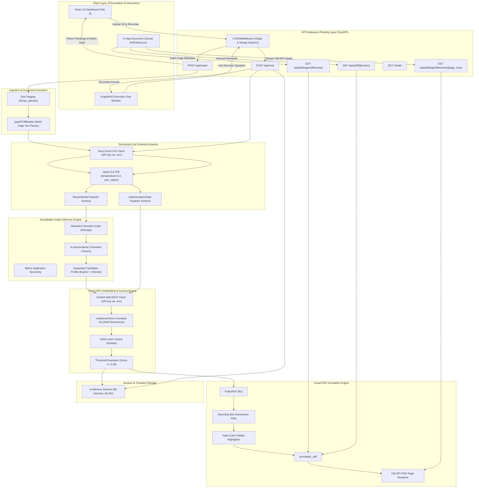

# SkillGraph ATS — Deep-Dive System Architecture

> **Document Version:** 2.0.0  
> **Last Updated:** October 15, 2026 | 00:25 IST  
> **Target Audience:** Software Architects, Machine Learning Engineers, Backend Developers, and Technical Auditors  
> **Subsystem Location:** `d:/MAJOR PROJECT - Copy/skillgraph-ats/app`

---

## 📌 Architectural Philosophy

Traditional Applicant Tracking Systems (ATS) rely primarily on exact lexical string matching or regular expressions. If a candidate lists `FastAPI`, `Docker`, and `PostgreSQL` on their resume, a legacy keyword-based filter will often reject them for a role requiring `Backend Engineering`, `Cloud Infrastructure`, or `Relational Databases`.

**SkillGraph ATS** replaces brute-force keyword matching with a **multi-tiered, neuro-symbolic AI pipeline**:
1. **Symbolic Reasoning (Knowledge Graphs):** A directed acyclic graph (DAG) ontology models domain implication relationships ($A \xrightarrow{\text{implies}} B$).
2. **Dense Vector Semantics (Cloud GPU Embeddings):** 2048-dimensional vector representations computed via **NVIDIA NIM Cloud API** (`nvidia/nemotron-3-embed-1b`).
3. **Generative Information Extraction & Explainability:** Large Language Models hosted on Groq (`qwen/qwen3.8-27b`) extract structured Pydantic schemas and power an interactive, guardrailed recruiter chatbot (GraphRAG).
4. **Visual Document Verification:** Real-time PDF annotation with PyMuPDF ensures human recruiters can visually verify every algorithmic decision.

---

## 🏛️ Comprehensive Architecture Diagram



---

## 🧩 Detailed Subsystem Breakdown

### 1. Ingestion & Structured Extraction Subsystem

* **Source Files:** [`app/parser.py`](file:///d:/MAJOR%20PROJECT%20-%20Copy/skillgraph-ats/app/parser.py), [`app/schemas.py`](file:///d:/MAJOR%20PROJECT%20-%20Copy/skillgraph-ats/app/schemas.py)
* **Primary Responsibility:** Transforming unstructured, multi-layout PDF files into strictly typed, validated Python data structures.

#### Mechanism:
1. `pypdf.PdfReader` iterates over all pages of the document, extracting raw character streams while sanitizing carriage returns.
2. The raw text is passed to **Groq's LPU Inference Engine** running `qwen/qwen3.8-27b`.
3. The prompt explicitly embeds the JSON Schema generated dynamically by Pydantic: `ResumeData.model_json_schema()` and `JobDescriptionData.model_json_schema()`.
4. The generation is locked to **`temperature=0.2`** and `response_format={"type": "json_object"}`. This guarantees that:
   - Output conforms strictly to valid JSON syntax.
   - Skill names and technology terms are extracted deterministically without hallucination.

```python
# app/parser.py
response = client.chat.completions.create(
    model="qwen/qwen3.8-27b",
    messages=[{"role": "user", "content": prompt}],
    response_format={"type": "json_object"},
    temperature=0.2
)
return json.loads(response.choices[0].message.content)
```

---

### 2. Knowledge Graph Symbolic Reasoning Subsystem

* **Source File:** [`app/graph.py`](file:///d:/MAJOR%20PROJECT%20-%20Copy/skillgraph-ats/app/graph.py)
* **Primary Responsibility:** Uncovering latent competencies that a candidate possesses by virtue of working with specific technologies, even if high-level buzzwords are omitted from the resume.

#### Graph Theory & Mathematical Formulation:
Let $G = (V, E)$ be a directed acyclic graph where:
- $V$ is the set of skill and technology vertices (e.g., `FastAPI`, `Docker`, `PyTorch`).
- $E \subseteq V \times V$ is the set of directed edges representing domain implication:
  $$(u, v) \in E \iff \text{competency in } u \implies \text{competency in } v$$

When a candidate explicitly lists skills $S_{\text{explicit}} \subseteq V$, the inference engine computes the transitive closure over the graph descendants:
$$S_{\text{inferred}} = \bigcup_{u \in S_{\text{explicit}}} \text{Descendants}(G, u)$$
$$S_{\text{expanded}} = S_{\text{explicit}} \cup S_{\text{inferred}}$$

#### Implemented Domain Relationships in `graph.py`:
| Explicit Technology ($u$) | Implied Latent Competency ($v$) |
| :--- | :--- |
| **`FastAPI`** | `Python`, `REST APIs`, `Backend Development` |
| **`Docker`** | `Containerization`, `Cloud Infrastructure` |
| **`Kubernetes`** | `Containerization`, `Cloud Infrastructure` |
| **`PostgreSQL`** | `SQL`, `Database Administration` |
| **`PyTorch`** | `Deep Learning`, `Machine Learning`, `Python` |
| **`RAG`** | `Vector Databases`, `Information Retrieval`, `NLP` |
| **`GitHub Actions`** | `CI/CD Pipelines`, `DevOps` |
| **`React`** | `JavaScript`, `Frontend Development`, `Single Page Applications` |

---

### 3. Dense Cloud GPU Semantic Matching Subsystem

* **Source File:** [`app/matcher.py`](file:///d:/MAJOR%20PROJECT%20-%20Copy/skillgraph-ats/app/matcher.py)
* **Primary Responsibility:** Computing mathematical similarity between candidate profiles and job requirements across 2048-dimensional vector space.

#### Cloud API Offloading vs. Local Models:
* **Previous Implementation:** Local `sentence-transformers` (`all-MiniLM-L6-v2`) running on CPU. Required PyTorch, consumed 1.5–2 GB of local RAM, and bottlenecked server response times.
* **Current Implementation:** **NVIDIA NIM Cloud API** (`nvidia/nemotron-3-embed-1b`). Runs on NVIDIA enterprise GPU clusters, returns normalized embeddings in under 150 ms with zero local compute strain.

#### Vector Matching Formulation:
1. Let $\mathbf{C} = \{\mathbf{c}_1, \mathbf{c}_2, \dots, \mathbf{c}_m\}$ be the set of $L_2$-normalized 2048-dimensional embedding vectors for the candidate's expanded profile.
2. Let $\mathbf{R} = \{\mathbf{r}_1, \mathbf{r}_2, \dots, \mathbf{r}_n\}$ be the set of embedding vectors for the job description's required skills.
3. Compute the pairwise Cosine Similarity Matrix:
   $$S_{i, j} = \cos(\mathbf{r}_i, \mathbf{c}_j) = \frac{\mathbf{r}_i \cdot \mathbf{c}_j}{\|\mathbf{r}_i\| \|\mathbf{c}_j\|} \in [-1, 1]$$
4. A requirement $\mathbf{r}_i$ is declared **matched** if:
   $$\max_{j} S_{i, j} \ge \tau \quad (\tau = 0.40)$$
5. The overall candidate match percentage is computed as:
   $$\text{Match Score} = \left(\frac{\sum_{i=1}^n \mathbb{I}\left(\max_j S_{i, j} \ge \tau\right)}{n}\right) \times 100$$

---

### 4. Visual PDF Annotation & Page Streaming Subsystem

* **Source Files:** [`app/annotator.py`](file:///d:/MAJOR%20PROJECT%20-%20Copy/skillgraph-ats/app/annotator.py), [`app/main.py`](file:///d:/MAJOR%20PROJECT%20-%20Copy/skillgraph-ats/app/main.py), [`frontend/src/components/PdfViewer.jsx`](file:///d:/MAJOR%20PROJECT%20-%20Copy/skillgraph-ats/frontend/src/components/PdfViewer.jsx)
* **Primary Responsibility:** Delivering visual proof of algorithmic matches directly on the candidate's original resume document without forced downloads or browser plugin crashes.

#### Bounding-Box Overlap Collision Detection:
When highlighting multi-term phrases, simple string search can cause overlapping highlight rectangles that obscure text or clash in color. `app/annotator.py` implements a geometric collision filter:
$$\text{Overlap Ratio}(R_1, R_2) = \frac{\text{Area}(R_1 \cap R_2)}{\min(\text{Area}(R_1), \text{Area}(R_2))}$$
If $\text{Overlap Ratio} > 0.30$, subsequent highlight annotations for that region are dropped to maintain visual clarity.

#### Triple-Color Palette:
* 🟢 **Vibrant Green** (`RGB: [0.35, 0.88, 0.35]`): Direct semantic matches with target JD requirements.
* 🟣 **Soft Purple** (`RGB: [0.85, 0.60, 0.95]`): Projects and technical implementation tools.
* 🔵 **Sky Blue** (`RGB: [0.45, 0.75, 1.00]`): Other extracted candidate skills.

#### High-DPI Page Streaming:
Rather than serving the raw PDF directly to an `<iframe>` (which triggers Chromium's dark gray blank `#525659` plugin frame and auto-downloads), `app/main.py` uses PyMuPDF's rasterizer:
```python
# app/main.py
page = doc[page_num - 1]
pix = page.get_pixmap(dpi=150)
return Response(content=pix.tobytes("png"), media_type="image/png")
```
The React frontend displays these as standard `` cards inside [`PdfViewer.jsx`](file:///d:/MAJOR%20PROJECT%20-%20Copy/skillgraph-ats/frontend/src/components/PdfViewer.jsx). An image element **never auto-triggers a download** and **never fails to render across browsers**.

---

### 5. GraphRAG Recruiter Chat Subsystem

* **Source File:** [`app/main.py`](file:///d:/MAJOR%20PROJECT%20-%20Copy/skillgraph-ats/app/main.py) (`recruiter_chat`)
* **Primary Responsibility:** Enabling recruiters to interrogate the candidate's score, explore project depth, and evaluate suitability through natural conversation.

#### Strict Domain Guardrails & Context Injection:
The chat endpoint injects the structured match data directly into the system prompt:
- Target Job Requirements
- Candidate Explicit Skills & Inferred Latent Skills
- Matched Requirements & Missing Skills
- Candidate Projects with Technology Badges

```text
STRICT GUARDRAILS:
1. You must ONLY answer questions related to this specific candidate's skills, gaps, or fit for the role.
2. If the user asks you to write code, tell a joke, solve math, or answer general knowledge questions, you MUST refuse and reply exactly: "I am a recruiting assistant. I can only answer questions related to candidate evaluation."
3. Do not hallucinate skills; only reference the 'explicit_skills' or 'inferred_skills' provided in the context data.
```
The temperature is locked at **`0.3`**, preventing speculative answers while preserving natural recruiter dialog.

---

## 🔒 Security Architecture & Privacy Boundaries

1. **Environment Credentials:** All API keys (`GROQ_API_KEY`, `NVIDIA_API_KEY`) are managed strictly through environment variables loaded via `python-dotenv`. No keys are baked into images, code, or client bundles.
2. **CORS Isolation:** CORS is configured with explicit origins (`http://localhost:5173`, `http://127.0.0.1:8000`) and exposed streaming headers (`Accept-Ranges`, `Content-Range`, `Content-Length`).
3. **Transient File Lifecycle:** Uploaded files and generated annotated PDFs reside in `temp_uploads/`. Basenames are sanitized via `os.path.basename` to prevent path-traversal attacks (`../../etc/passwd`).
4. **Zero Client-Side Compute Spikes:** All heavy ML calculations run server-side or cloud-side, keeping client RAM consumption below 50 MB.
