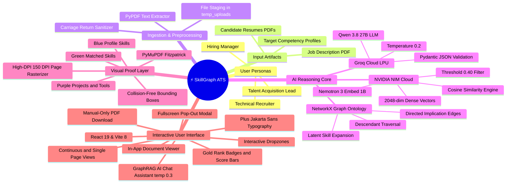
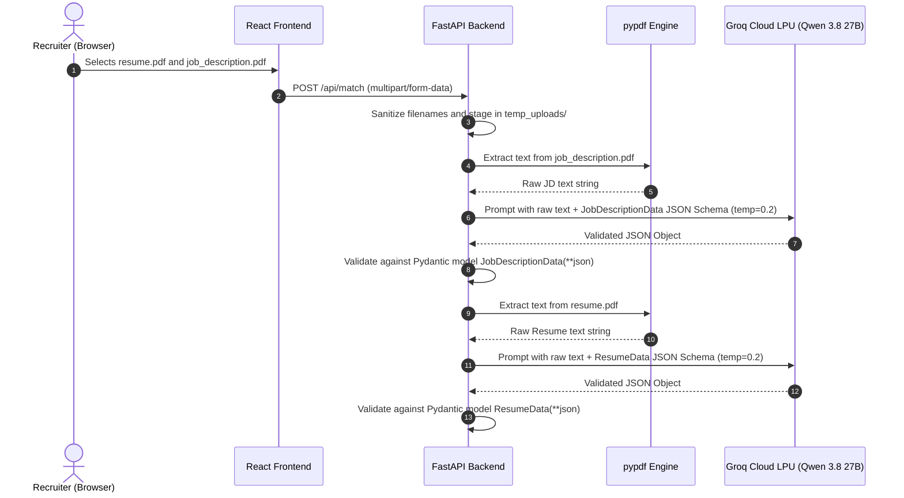
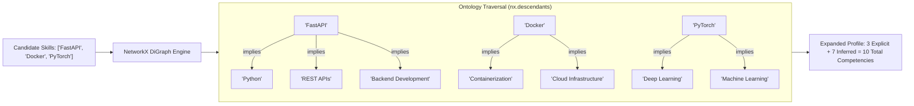
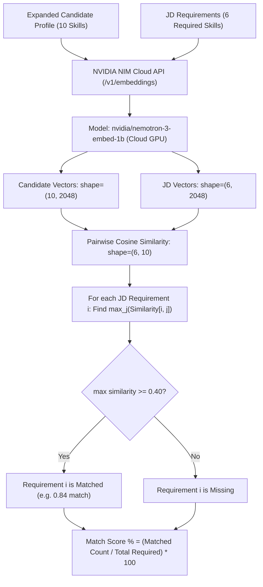
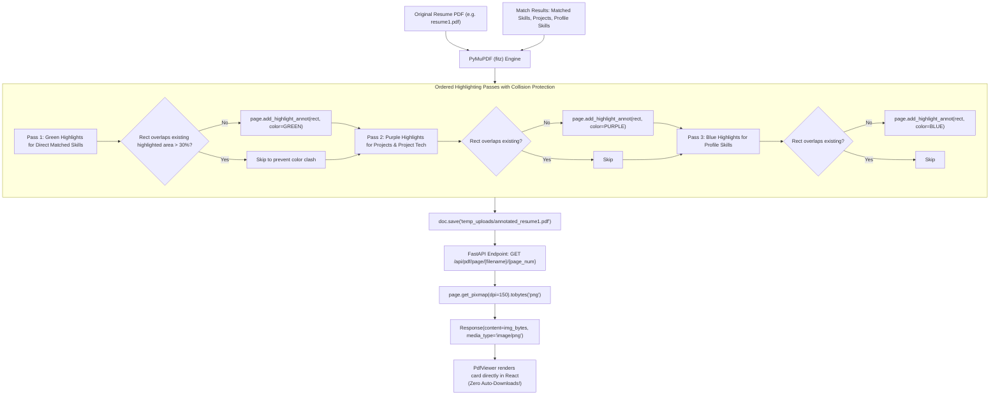
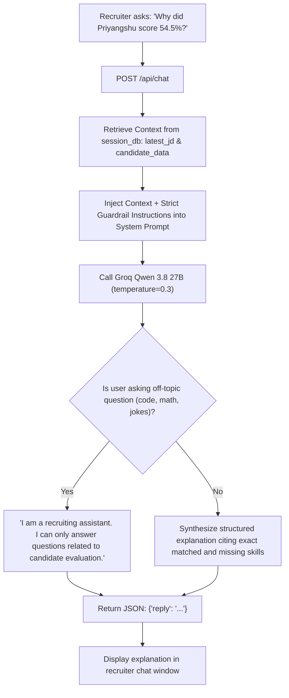
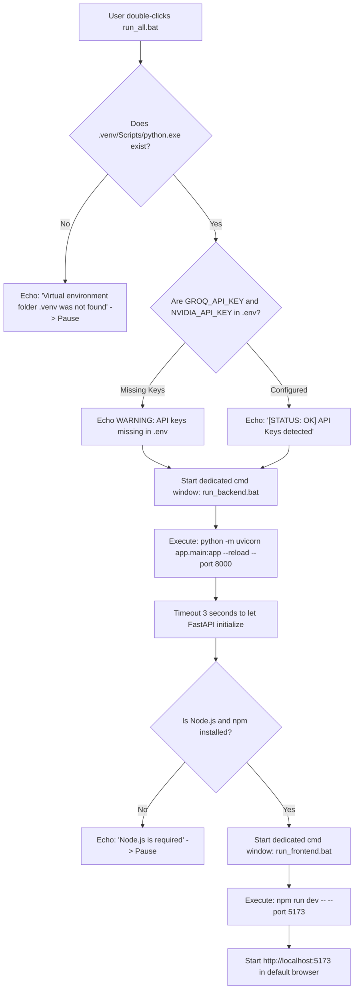

# SkillGraph ATS — Detailed Workflows, Mind Maps & Data-Flow Diagrams

> **Document Version:** 2.0.0  
> **Last Updated:** October 15, 2026 | 00:25 IST  
> **Target Audience:** Developers, Integrators, QA Engineers, and Technical Reviewers  
> **Related Architecture Document:** [`docs/architecture.md`](file:///d:/MAJOR%20PROJECT%20-%20Copy/docs/architecture.md)

---

## 🧠 1. Platform Taxonomy Mind Map

This mind map visualizes how users, user interfaces, cloud AI services, inference engines, and data artifacts connect across SkillGraph ATS:

### 📖 Plain-English Explanation:
The platform connects **Recruiters and Hiring Managers** directly to candidates through an intelligent, automated pipeline. Instead of relying on manual resume scanning, the system accepts raw PDF documents, structures them with **Groq AI**, expands hidden competencies with **NetworkX Knowledge Graphs**, calculates mathematical match confidence with **NVIDIA Cloud GPUs**, paints visual proof directly on the resume with **PyMuPDF**, and presents it all within a high-performance **React 19** dashboard.

---

## 🔄 2. End-to-End Pipeline Workflow (User Action to Output)

The diagram below maps the complete user journey from uploading files to inspecting match scores and interrogating the GraphRAG recruiter assistant. It highlights all decision branches and failure recovery paths.

```mermaid
flowchart TD
    Start(["User Opens Dashboard http://localhost:5173"]) --> DropFiles["User Drops JD PDF & Resume PDFs into Dropzones"]
    DropFiles --> ClickMatch{"User Clicks 'Calculate Match Scores'"}

    ClickMatch -->|Missing Files| WarnUser["Alert: 'Please select a Job Description and at least one Resume'"]
    WarnUser --> DropFiles

    ClickMatch -->|Files Valid| SendMultipart["POST /api/match (Multipart FormData)"]
    SendMultipart --> SaveStaging["Save to temp_uploads/ with Sanitized Basenames"]

    SaveStaging --> ExtractJD["pypdf: Extract Raw Text from JD PDF"]
    ExtractJD --> ParseJDGroq["Groq LLM (Qwen 3.8 27B, temp=0.2): Extract JobDescriptionData Schema"]

    ParseJDGroq -->|JD LLM Failure| ReturnErr500["Return HTTP 500: Failed to parse JD"]
    ReturnErr500 --> ShowUIError["Dashboard displays error alert to recruiter"]

    ParseJDGroq -->|JD Parsed Successfully| LoopResumes["Iterate Over Each Candidate Resume PDF"]

    subgraph Candidate_Processing_Loop ["Per-Candidate Processing Pipeline"]
        LoopResumes --> ExtractResText["pypdf: Extract Raw Text from Candidate Resume PDF"]
        ExtractResText --> ParseResGroq["Groq LLM (temp=0.2): Extract ResumeData Schema"]
        
        ParseResGroq --> GraphExpansion["NetworkX: Traverse Descendants for Latent Skills"]
        GraphExpansion --> BuildProfile["Assemble Expanded Profile (Explicit + Latent + Projects)"]

        BuildProfile --> NvidiaEmbed["NVIDIA NIM Cloud API: Fetch 2048-dim Vectors"]
        NvidiaEmbed -->|NVIDIA API Error| FallbackEmbed["Raise RuntimeError: NVIDIA NIM API Error"]
        
        NvidiaEmbed --> CosineCalc["Scikit-Learn: Compute Cosine Similarity Matrix against JD Requirements"]
        CosineCalc --> ScoreThreshold{"Cosine Similarity >= 0.40?"}
        ScoreThreshold -->|Yes| MarkMatched["Add to matched_requirements"]
        ScoreThreshold -->|No| MarkMissing["Add to missing_skills"]

        MarkMatched & MarkMissing --> CalcScore["Compute Match Score %: (Matched / Total Required) * 100"]
        CalcScore --> AnnotatePDF["PyMuPDF: Apply Green, Purple & Blue Highlights with Collision Filtering"]
        AnnotatePDF --> SaveAnnotPDF["Save temp_uploads/annotated_<filename>.pdf"]
        SaveAnnotPDF --> CalcPages["Pre-calculate total page count & /api/pdf/page/ stream URLs"]
    end

    CalcPages --> RankCandidates["Sort candidates descending by Match Score"]
    RankCandidates --> CacheSession["Save latest_jd & latest_rankings to session_db"]
    CacheSession --> ReturnJSON["Return JSON response to React Dashboard"]

    ReturnJSON --> RenderDashboard["React renders Candidate Cards, Score Bars, and Dropdowns"]
    RenderDashboard --> SelectCandidate["Default select Candidate #1"]

    SelectCandidate --> StreamDoc["PdfViewer fetches page images from /api/pdf/page/{file}/{num}"]
    StreamDoc --> DisplayResume["Resume displays with 100% vector highlights, zero download popups!"]

    DisplayResume --> UserActionChoice{"Recruiter Next Action"}

    UserActionChoice -->|Wants Fullscreen View| OpenModal["Click '⛶ Fullscreen Inspector' -> Opens high-res modal"]
    UserActionChoice -->|Wants to Save PDF| ClickDownload["Click '📥 Download PDF' -> Saves annotated_resume.pdf to computer"]
    UserActionChoice -->|Wants Explanation| AskChat["Type question in GraphRAG Chat Window"]

    AskChat --> SendChatQuery["POST /api/chat with candidate_name & question"]
    SendChatQuery --> CheckGuardrail{"Question within domain?"}
    CheckGuardrail -->|Off-topic / Code / General| RefuseReply["Reply: 'I am a recruiting assistant. I can only answer...'"]
    CheckGuardrail -->|Evaluation Question| GroundedReply["Groq LLM (temp=0.3) synthesizes answer from Graph Context"]
    RefuseReply & GroundedReply --> DisplayChat["Show answer in Chat Window"]
```

### 📖 Plain-English Explanation:
1. **Initiation:** The recruiter drops a job description and resumes into the dashboard and clicks **"Calculate Match Scores"**.
2. **Validation:** If files are missing, the UI prompts for them immediately.
3. **Extraction & Inference:** The backend extracts text, parses schemas via Groq, expands implied skills via NetworkX, and offloads vector comparison to NVIDIA Cloud.
4. **Visual Annotation:** PyMuPDF highlights the matching resume sections directly on the document.
5. **Presentation:** The frontend renders ranked candidate cards, visual score bars, and streams document pages with zero unwanted downloads.
6. **Exploration:** The recruiter can zoom in, toggle continuous pages, view fullscreen, download a copy if desired, or chat with the AI about specific candidate qualifications.

---

## 🔍 3. Feature-Specific Workflows

### Feature A: Document Ingestion & Structured Schema Parsing

#### Explanation:
By strictly passing the Pydantic schema definition to Groq with `temperature=0.2` and `response_format={"type": "json_object"}`, the model cannot return free-form conversational text. It returns validated JSON contracts that Python parses directly into typed data objects.

---

### Feature B: Latent Skill Inference via Graph Traversal

#### Explanation:
A candidate who built a project using `FastAPI` might not write "REST APIs" or "Backend Development" in their resume skills list. The NetworkX engine traverses directed implication edges to infer these latent competencies automatically.

---

### Feature C: NVIDIA Cloud Semantic Vector Matching

#### Explanation:
Vector embeddings capture semantic meaning rather than literal spelling. Because embeddings run on NVIDIA NIM Cloud GPUs, high-dimensional 2048-element vectors are generated in under 150 milliseconds without consuming local CPU or memory.

---

### Feature D: Visual Resume Annotation & Page Streaming

#### Explanation:
By rasterizing each annotated page to a crisp 150 DPI image on demand, the browser receives pure image data. This completely bypasses the browser's PDF plugin, guaranteeing that:
1. No black or gray `#525659` boxes appear.
2. The browser never automatically downloads the PDF when viewing match results.
3. Text and highlights remain razor sharp.

---

### Feature E: GraphRAG Recruiter Assistant with Strict Guardrails

#### Explanation:
The GraphRAG recruiter assistant acts as an explainable auditor. It has access to the candidate's exact graph inference data, missing requirements, and match scores. The strict guardrails and `0.3` temperature setting prevent the model from drifting into hallucination or answering non-recruitment queries.

---

## ⚡ 4. 1-Click Launchers Execution Flow

### 📖 Plain-English Explanation:
The `run_all.bat` launcher removes all manual terminal setup for Windows users. It automatically verifies your Python virtual environment, validates your API keys, checks that Node.js is present, opens the backend and frontend in separate dedicated windows, and launches your web browser directly to the dashboard.
