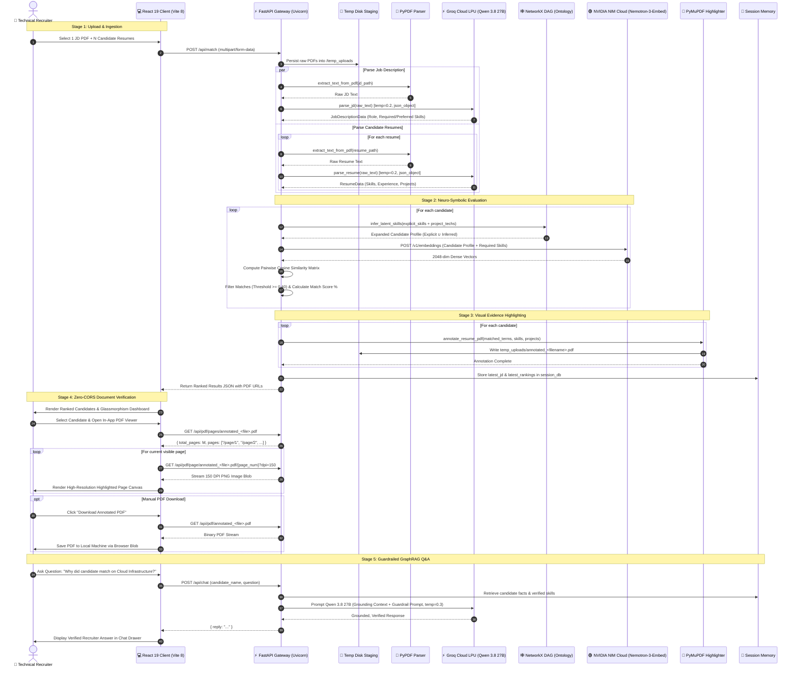
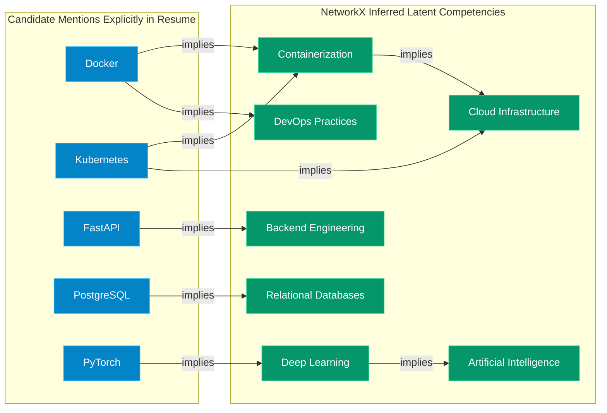

# 📊 SkillGraph ATS — Complete Data Flow & Architecture Diagrams

> **System Overview:** Visual representation of the neuro-symbolic recruitment pipeline, combining symbolic Knowledge Graphs, dense 2048-dimensional Cloud GPU vector embeddings, deterministic LLM schema extraction, automated PDF visual evidence annotation, and guardrailed GraphRAG recruiter chat.

---

## 1. End-to-End System Sequence Diagram

The sequence diagram below models the complete lifecycle of a recruitment evaluation run — from multi-file PDF ingestion to the real-time presentation of visual proof and AI-powered candidate Q&A:

---

## 2. Neuro-Symbolic Multi-Tiered Evaluation Flow

This flowchart illustrates the two distinct branches of our AI scoring engine: the **Symbolic Knowledge Graph** and the **Sub-Symbolic Cloud Vector Space**:

```mermaid
flowchart TD
    classDef startEnd fill:#1e293b,stroke:#3b82f6,stroke-width:2px,color:#fff;
    classDef llmNode fill:#1e1b4b,stroke:#818cf8,stroke-width:2px,color:#fff;
    classDef graphNode fill:#064e3b,stroke:#10b981,stroke-width:2px,color:#fff;
    classDef embedNode fill:#0f172a,stroke:#22c55e,stroke-width:2px,color:#fff;
    classDef visualNode fill:#701a75,stroke:#f472b6,stroke-width:2px,color:#fff;
    classDef guardNode fill:#7c2d12,stroke:#f97316,stroke-width:2px,color:#fff;

    Start([📄 Raw Multi-Page Resumes & JD]):::startEnd --> TextExtract[PyPDF Text Ingestion]
    
    subgraph Ingestion_Extraction ["Deterministic Information Extraction"]
        TextExtract --> GroqPrompt["Groq LPU Engine\nModel: qwen/qwen3.8-27b\nConfig: temperature=0.2, json_object"]:::llmNode
        GroqPrompt --> SchemaValidation["Pydantic Schema Validation\nResumeData & JobDescriptionData"]:::llmNode
    end

    SchemaValidation --> Split{"Separate Pathways"}

    subgraph Symbolic_Reasoning ["Tier 1: Symbolic Knowledge Graph Deduction"]
        Split -->|Candidate Skills & Projects| AggregateExplicit["Extract Explicit Skills & Project Tools"]
        AggregateExplicit --> NetworkXDAG["NetworkX Directed Graph (DiGraph)\nDomain Ontology: Tool → Concept Implication"]:::graphNode
        NetworkXDAG --> TransitiveClosure["Traverse Graph:\nnx.descendants(graph, skill)"]:::graphNode
        TransitiveClosure --> ExpandedProfile["Compute Profile Union:\nExplicit Skills ∪ Latent Inferred Competencies"]:::graphNode
    end

    subgraph Dense_Semantics ["Tier 2: Dense Cloud GPU Vector Semantics"]
        ExpandedProfile & Split -->|JD Requirements| NVIDIAEmbed["NVIDIA NIM Cloud API\nModel: nvidia/nemotron-3-embed-1b\nOutput: 2048-dim Vectors"]:::embedNode
        NVIDIAEmbed --> CosineCalc["Calculate Cosine Similarity Matrix:\nSim(u, v) = (u · v) / (||u|| ||v||)"]:::embedNode
        CosineCalc --> ThresholdGate{"Cosine Sim >= 0.40?"}:::embedNode
        ThresholdGate -->|Yes| RegisterMatch["Mark Skill as Matched\nStore Confidence Score"]
        ThresholdGate -->|No| RegisterMissing["Mark Requirement as Missing"]
        RegisterMatch & RegisterMissing --> FinalScore["Compute Weighted Match Percentage:\nScore = (|Matched| / |Total Required|) * 100"]
    end

    subgraph Visual_Verification ["Tier 3: Visual Proof & Annotation Engine"]
        FinalScore --> PyMuPDFEngine["PyMuPDF (fitz) Color Highlighter"]:::visualNode
        PyMuPDFEngine --> YellowBox["🟨 Matched Requirements [1.0, 0.9, 0.2]"]:::visualNode
        PyMuPDFEngine --> CyanBox["🟦 Profile Skills [0.2, 0.8, 1.0]"]:::visualNode
        PyMuPDFEngine --> MagentaBox["🟪 Projects & Tech [0.9, 0.4, 0.9]"]:::visualNode
        YellowBox & CyanBox & MagentaBox --> AnnotatedPDF["Save temp_uploads/annotated_<file>.pdf"]:::visualNode
    end

    subgraph Zero_CORS_Streaming ["Tier 4: Zero-CORS Document Delivery"]
        AnnotatedPDF --> PageManifest["GET /api/pdf/pages/{file}\nReturn Page Count Manifest"]
        PageManifest --> PNGStreamer["GET /api/pdf/page/{file}/{num}?dpi=150\nRender High-DPI PNG Pixmap"]
        PNGStreamer --> ReactCanvas["In-App React 19 Document Canvas\n(PdfViewer.jsx)"]
    end

    subgraph Recruiter_Assistant ["Tier 5: Guardrailed GraphRAG Recruiter Chat"]
        ReactCanvas --> UserQuestion["Recruiter Asks Candidate-Specific Question"]
        UserQuestion --> GuardrailCheck{"Domain Guardrail Check\nIs question strictly about candidate evaluation?"}:::guardNode
        GuardrailCheck -->|Off-Topic / Code / Jokes| RejectResponse["Deterministic Guardrail Refusal:\n'I am a recruiting assistant. I can only answer\nquestions related to candidate evaluation.'"]:::guardNode
        GuardrailCheck -->|Valid Candidate Question| GroundedInference["Groq Qwen 3.8 27B (temp=0.3)\nGround context strictly in verified match data"]:::guardNode
        GroundedInference --> ExplanationReply["Return Accurate, Hallucination-Free Explanation"]
    end
```

---

## 3. Knowledge Graph Ontology Deduction Model

The diagram below demonstrates how specific tool mentions trigger parent competency inferences in `skillgraph-ats/app/graph.py`:

---

## 4. Zero-CORS vs. Legacy Browser PDF Handling

```mermaid
graph TD
    subgraph Legacy_Failure_Mode ["❌ Legacy Browser In-Frame Rendering (Flawed)"]
        OldClient["Browser Window"] -->|iframe / embed| CrossOriginReq["Cross-Origin PDF Request"]
        CrossOriginReq --> IframeSandbox["Browser Iframe Security Sandbox Block"]
        IframeSandbox --> ErrorPrompt["❌ Error: Failed to load PDF with Mozilla PDF.js engine"]
        ErrorPrompt --> ForcedDownload["Unwanted Auto-Download of PDF File to User Downloads Folder"]
    end

    subgraph SkillGraph_Zero_CORS ["✅ SkillGraph Zero-CORS Rasterization Pipeline (Robust)"]
        NewClient["React 19 Dashboard"] -->|1. Request Manifest| ManifestRoute["GET /api/pdf/pages/{filename}"]
        ManifestRoute --> ManifestResp["Manifest: { total_pages: 2, pages: ['/page/1', '/page/2'] }"]
        NewClient -->|2. Request Rendered Page| PixmapRoute["GET /api/pdf/page/{filename}/{page_num}?dpi=150"]
        PixmapRoute --> PyMuPDFPix["PyMuPDF Server-Side Pixmap Rasterization"]
        PyMuPDFPix --> PNGStream["image/png Stream (Zero Cross-Origin Blocking)"]
        PNGStream --> CanvasRenderer["Smooth, Native <img> Canvas in React with Zoom & Page Flipping"]
        NewClient -.->|3. Only On Explicit User Click| DecoupledDownload["GET /api/pdf/{filename} -> Save File As Blob"]
    end
```

